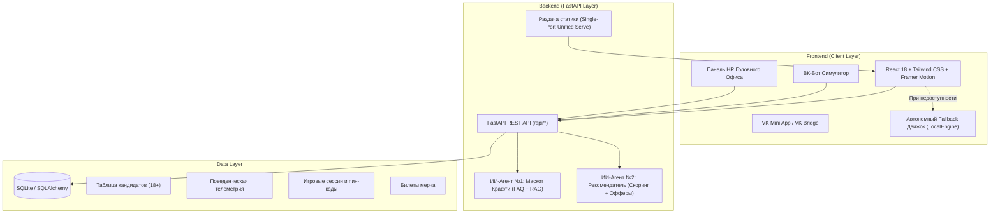

# ОЧАКОВО: Секретный код 1978

Экосистема для привлечения, пребординга и удержания молодых специалистов 18–26 лет в АО МПБК «ОЧАКОВО». Кейс компании на хакатоне «Открой#Моспром» 2026.

[](https://fastapi.tiangolo.com)
[](https://react.dev)
[](https://tailwindcss.com)
[](https://vk.com/dev/vk_apps_docs)
[](https://docker.com)
[](https://pytest.org)

## 1. Какие проблемы кейса закрывает решение

| Проблема кейса | Как было | Что делает «Секретный код 1978» | Ожидаемый результат |
|---|---|---|---|
| Молодёжь 18–26 лет не видит в «Очаково» современного технологичного работодателя | Компанию знают как производителя кваса и лимонадов на полке | Детективный квест «от поля до банки» показывает масштаб (10 заводов с нуля, 100% российский капитал, мировые рекорды 1994–1996 гг.) и технику (ATAGO RX-7000i, мнемосхемы МЭА, линии SMI SK 500 P) | Образ высокотехнологичного отечественного лидера |
| Сезонный пик (март–август/сентябрь) | Не хватает сотен специалистов на варке, розливе, в лаборатории, инженерии и на складе | Калькулятор дохода (56 тыс. – 70 тыс. ₽ и выше) с повышенным тарифом за ночные смены и компенсацией 50% питания, плюс возможность сдать сессию на заводе | Пул студентов 3–4 курсов и выпускников, готовых выйти в сезон |
| Старение коллектива (средний возраст 47 → 52 года) | Разрыв поколений, уходит экспертиза гранд-мастеров | «Мост поколений 20+ и 52 года»: в досье кандидата ИИ подбирает персонального наставника (Елена Морозова, 49 лет; Виктор Громов, 54 года; Михаил Соколов, 52 года) | Передача опыта и преемственность мастерства |
| Высокий отсев на испытательном сроке (38%) | Люди уходят, потому что не знали реальных условий труда, быта и графика 2/2 | Пребординг в игре: настоящие СИЗ, симулятор бракеража SMI SK 500 P, титрование, открытые условия быта (общежитие за 3 400 ₽ на Рябиновой 36к2, столовая за 50%, график 2/2) | Прогноз снижения отсева с 38% до 9% |
| Низкая конверсия (0,02%) | Классические джоб-борды студентов не вовлекают | VK Mini App, магазин лимитированного мерча за баллы («Я делаю натуральные напитки»), автозаполнение анкеты через VK ID | Прогноз роста конверсии в анкету до 7,1% |

> [!IMPORTANT]
> На работу, практику и стажировку принимают строго с 18 лет. Возраст проверяется дважды, на клиенте и на сервере, по числу полных лет от даты рождения.

## 2. Доступ для жюри

Панель HR и симулятор бота закрыты корпоративным входом, но эксперты хакатона заходят без блокировок:

1. Корпоративный ключ HR: `Ochakovo#HR525!` (задаётся в `backend/.env`, переменная `HR_ACCESS_KEY`). Старый PIN `1978` работает как запасной вход; отключить его можно через `HR_ALLOW_LEGACY_PIN=0`.
2. В окне входа есть кнопка «⚡ Быстрый вход для Эксперта Жюри (1 клик)»: она подставляет ключ и сразу открывает служебный контур (в мини-приложении это вкладка «Жюри»).
3. `POST /api/auth/login` сравнивает ключ за постоянное время (`hmac.compare_digest`) и выдаёт токен HMAC-SHA256 на 12 часов. Фронт передаёт его в заголовке `X-HR-Token`, проверка идёт через `GET /api/auth/check`.
4. Если бэкенд недоступен, фронт проверяет ключ локально, так что показ жюри не зависит от сети.

## 3. Продукт

Экосистема состоит из трёх режимов. Между ними можно переключаться кнопкой «Режим жюри».

### Режим 1. VK Mini App: квест и пребординг

- Сюжет. В 1978 году, перед Олимпиадой-80, в будущей Лаборатории экспериментального пивоварения (ЛЭП) заложили Капсулу Мастерства. Замок открывается 4-значным кодом, который генерируется для каждой сессии, так что списать его нельзя.
- Карточки «Почему именно ОЧАКОВО?». Пять фактов: 10 заводов без иностранного капитала, нет испытательного срока для студентов, общежитие за 3 400 ₽ в месяц, сессия на предприятии, мировые рекорды.
- Станция 0, «Раздевалка и СИЗ». Герой надевает спецодежду с манифестом «Я ДЕЛАЮ НАТУРАЛЬНЫЕ НАПИТКИ» и выбирает обувь, перчатки и беруши.
- Четыре станции:
  1. Лаборатория (химики-лаборанты): титрование по каплям, измерение Brix на цифровом рефрактометре ATAGO RX-7000i, органолептический тест CoolCola и лимонадов. Даёт первую цифру кода.
  2. Инженерия и техцех (машинисты и наладчики): давление в абсорбере CO2 (1,8–2,2 бар), авария моноэтаноламина (МЭА), обход барботёра №1 с KMnO4, заторно-варочного чана №1 ЛЭП и резервуаров SCHENK. Вторая цифра.
  3. Линия розлива и склад (операторы и логисты): бракераж банок «Мохито Fresh» и «Джин & Грейпфрут» на конвейере упаковщика SMI SK 500 P, сборка паллеты по товарно-транспортной накладной (ТТН). Третья цифра.
  4. Дизайн, IT и Mirapolis: подбор оттенка Pantone для банки напитка KERN и управленческий тест Mirapolis (SMART, SWOT, диаграмма Исикавы, «5 почему»). Четвёртая цифра.
- Капсула и розыгрыш мерча. Игрок вводит собранный код, видит формулу ОЧАКОВО и покупает за баллы билеты на розыгрыш мерча: худи, крафт-бокс KERN/CoolCola, VIP-экскурсия на завод и в музей.
- ИИ-рекомендация, калькулятор выгоды и анкета 18+. Приложение считает доход и экономию до 35 000 ₽ на жилье и питании, заполняет анкету через VK ID и открывает «Справочник первого дня» (Рябиновая, 44; общежитие на Рябиновой, 36к2; здравпункт 1370; Учебный центр, каб. 525).

### Карта производств (Leaflet и фото цехов)

- «География Очаково в РФ (10 заводов с нуля)»: карта России на тайлах OpenStreetMap с пинами предприятий (Москва, Краснодар, Пенза, Тюмень, Тербуны/Липецк, Тамань/ЮВК) и плашкой про 100% российский капитал и поставки в 60 регионов и 30+ стран.
- «Кампус Москва (Рябиновая, 44)»: план территории с шестью объектами: Центральная лаборатория и R&D (от 60 000 ₽, ATAGO RX-7000i), технологический цех (от 70 000 ₽, SCHENK, ЛЭП, CO2/МЭА), цех розлива (от 70 000 ₽, SMI SK 500 P), складской комплекс (56 000–60 000 ₽, ТТН), Учебный центр, каб. 525, и музей (практика с защитой диплома и сдачей сессии на заводе), общежитие на Рябиновой, 36к2 (3 400 ₽ в месяц, столовая за 50%, здравпункт 1370).
- В галерее каждого цеха лежат реальные кадры из обучающих видео комбината (`/workshops/`).
- За первое изучение каждого цеха начисляется +15 крафт-баллов. Кнопка «Выбрать этот цех для практики / стажировки» сразу подставляет цех в анкету.
- Карту можно переключить на векторную схему: для кампуса это генеральный план с кликабельными объектами, для России список филиалов. Схема включается сама, если тайлы не загрузились (сначала приложение пробует резервное зеркало OSM).
- Изученные локации и выбранный цех попадают в HR-досье и в таблицу кандидатов, так что HR видит мотивацию соискателя.

### Режим 2. ВК-бот сообщества и маскот Крафти (ИИ-агент №1)

- Бот отвечает по базе знаний Справочника студента.
- Он относит вопросы кандидата к одной из 16 тем, которые вызывают тревогу (`dorm`, `salary`, `session`, `military`, `schedule` и другие), и передаёт их в HR-досье.
- Есть сценарии с клавиатурами ВК, пуш-уведомления и запуск Mini App.

### Режим 3. Панель HR головного офиса (ИИ-агент №2)

- Дашборд воронки: конверсия, прогноз снижения отсева с 38% до 9%, средний возраст соискателей 21,6 года против 52 лет по комбинату.
- ИИ-досье кандидата: радар из 5 производственных компетенций, прогноз удержания, выявленные риски и рекомендуемый тип наставника.
- Генератор оффера: ИИ пишет адресное приглашение с учётом баллов, сильных сторон и вопросов, которые кандидат задавал боту (например, про общежитие и сессию).
- Экспорт кандидатов в CSV (UTF-8 с BOM, открывается в Excel).

## 4. Архитектура



## 5. Быстрый запуск

### Через Docker

Образ собирается в несколько стадий: React SPA и FastAPI-бэкенд работают вместе на порту 8000.

```bash
docker compose up --build
```

После запуска приложение открывается на http://localhost:8000, проверка здоровья API на http://localhost:8000/api/health, документация Swagger на http://localhost:8000/docs.

### Локально, для разработки

Бэкенд (Python 3.10–3.14):

```bash
pip install -r backend/requirements.txt
cd backend && python -m uvicorn main:app --host 0.0.0.0 --port 8000 --reload
```

Фронтенд (Node.js 18+):

```bash
cd frontend
npm install
npm run dev
```

Фронтенд откроется на http://localhost:5173 и сам подключится к бэкенду на `http://localhost:8000`.

Тесты:

```bash
cd backend && python -m pytest test_perf_auth_inbox.py -v
```

## 6. API

Подробный контракт лежит в `API_CONTRACT.md`.

| Метод | Эндпоинт | Назначение |
|---|---|---|
| `GET` | `/api/health` | Проверка, что бэкенд отвечает |
| `POST` | `/api/sessions` / `/api/game/start-session` | Старт сессии и генерация уникального пин-кода |
| `POST` | `/api/telemetry` / `/api/game/evaluate-telemetry` | Запись событий игровой телеметрии |
| `POST` | `/api/mascot/chat` / `/api/ai/mascot-chat` | Диалог с маскотом «Крафти» и классификация тем |
| `POST` | `/api/recommendation` | Расчёт 5 компетенций, архетипа и совпадения с вакансиями |
| `POST` | `/api/raffle/tickets` | Покупка билетов розыгрыша мерча за баллы |
| `POST` | `/api/candidates` / `/api/candidates/submit` | Отправка анкеты (проверка возраста 18+) |
| `GET` | `/api/candidates` | Список кандидатов с фильтрами и сортировкой |
| `GET` | `/api/candidates/{id}/dossier` | Полное ИИ-досье кандидата для рекрутера |
| `POST` | `/api/candidates/{id}/mirapolis` | Назначение электронных курсов в СДО Mirapolis |
| `GET` | `/api/analytics/summary` / `/api/hr/dashboard` | Сводная аналитика воронки за сезон |
| `POST` | `/api/bot/message` | Обработка сообщений в ВК-боте |
| `POST` | `/api/bot/invite-draft` | Черновик персонального приглашения |
| `POST` | `/api/bot/send` | Сообщение кандидату от имени сообщества (сохраняется в `bot_messages`; при заданном `VK_GROUP_TOKEN` уходит через `messages.send`) |
| `GET` | `/api/bot/inbox` | Сообщения бота для вкладки «ВК-бот» по `session_id`, `candidate_id` или `since`; без параметров отдаёт последние приглашения HR |
| `POST` | `/api/auth/login` | Вход HR и режима жюри по корпоративному ключу, в ответ подписанный токен |
| `GET` | `/api/hr/export-csv` | Экспорт кандидатов в CSV (UTF-8 с BOM) |

### Оптимизация под слабый сервер

- GZip для ответов больше 500 байт. Дашборд HR и досье на мобильном интернете весят в 4–6 раз меньше.
- SQLite в режиме WAL (`synchronous=NORMAL`, кэш около 20 МБ, временные таблицы в памяти): панель HR читает, пока игроки пишут телеметрию и анкеты.
- Индексы на `candidates.session_id`, `created_at`, `target_vacancy` и на `bot_messages.session_id`, `created_at`, `sent_by`. В старой базе они создаются при старте.
- TTL-кэш на 15 секунд для `/api/hr/dashboard` и `/api/analytics/summary` (заголовок `X-Cache: HIT | MISS`). Он сбрасывается при новой анкете, сообщении HR, смене статуса и удалении данных.
- Общий `httpx.AsyncClient` для VK API и LLM: соединения переиспользуются, таймаут VK API равен 4 секундам (`HTTP_TIMEOUT`).

## 7. Фирменный стиль

Интерфейс следует брендбуку АО МПБК «Очаково».

- Цвета: Pantone 199 (`#D50032`, фирменный красный), Pantone Cool Gray 10 (`#626262`, тёмно-серый), Pantone 429 (`#A2AAAD`, стальной), белый (`#FFFFFF`).
- Шрифты: Proxima Nova / Montserrat для текста и JetBrains Mono для «инженерных» кодов.
- Айдентика: векторные логотипы, пиктограммы сырья и оборудования (солод, хмель, чан варки, ферментеры, рефрактометр), манифест на спецодежде «Я ДЕЛАЮ НАТУРАЛЬНЫЕ НАПИТКИ».
- Вёрстка рассчитана на мобильную ширину 375 px (VK Mini App) и на большие экраны для десктопа и презентаций.

## Команда

Хакатон «Открой#Моспром» 2026, кейс АО МПБК «Очаково». Команда: агент №1 (backend/AI), агент №2 (frontend/UX), агент №3 (fullstack-архитектор и QA).
