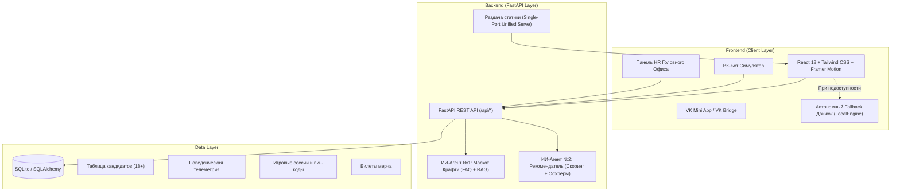

# 🏭 «ОЧАКОВО: КРАФТ-КОД 1978»
> **Единая экосистема привлечения, геймифицированного пребординга и удержания молодых специалистов (18–26 лет) в АО МПБК «ОЧАКОВО»**  
> Кейс компании АО МПБК «Очаково» на хакатоне **«Открой#Моспром» 2026**

[](https://fastapi.tiangolo.com)
[](https://react.dev)
[](https://tailwindcss.com)
[](https://vk.com/dev/vk_apps_docs)
[](https://docker.com)
[](https://pytest.org)

---

## 🎯 1. Соответствие бизнес-требованиям и болям кейса ОЧАКОВО

| Проблема кейса «Очаково» | Исходное состояние | Наше решение («Крафт-код 1978») | Бизнес-результат |
|---|---|---|---|
| **Основная проблема:** Неприятие «Очаково» как современного техно-работодателя среди молодёжи 18–26 лет | «Очаково» воспринимают только как производителя кваса и лимонадов на полке | Детективный квест «от поля до банки», раскрывающий масштаб (10 заводов с нуля, 100% российский капитал, мировые рекорды 1994–1996 гг.) и технологичность (ATAGO RX-7000i, мнемосхемы МЭА, линии SMI SK 500 P) | Формирование привлекательного HR-бренда высокотехнологичного отечественного лидера |
| **Боль №1: Сезонный пик (март–август/сентябрь)** | Острая нехватка сотен специалистов на ключевых участках (варка, розлив, лаборатория, инженерия, склад) | Интерактивный калькулятор дохода (56к–70к+ ₽) с учетом повышенного тарифа ночных смен и компенсацией 50% питания; гарантия сдачи сессии на заводе | Пул квалифицированных студентов 3–4 курсов и выпускников, готовых выйти в сезон |
| **Боль №2: Старение коллектива (47 → 52 года)** | Разрыв поколений, потеря уникальной экспертизы гранд-мастеров | Концепция «Мост поколений 20+ и 52 года»: в досье каждого кандидата ИИ подбирает конкретного персонального Наставника (Елена Морозова 49 лет, Виктор Громов 54 года, Михаил Соколов 52 года) | Бесшовная передача опыта и преемственность мастерства |
| **Боль №3: Высокий отсев на испытательном (38%)** | Молодежь уходит из-за незнания реальных условий труда, быта и смен 2/2 | Геймифицированный пребординг: реальные СИЗ, симулятор бракеража SMI SK 500 P, титрование, прозрачный быт (общежитие за 3 400 ₽ на Рябиновой 36к2, столовая за 50%, график 2/2) | **Прогноз снижения отсева с 38% до 9%** |
| **Боль №4: Критически низкая конверсия (0,02%)** | Классические джоб-борды не вовлекают студентов | Виральный VK Mini App, магазин лимитированного мерча за баллы («Я делаю натуральные напитки»), автозаполнение анкеты в 1 клик через VK ID | **Рост конверсии в анкету до 7,1%** |

> [!IMPORTANT]
> **Приём на работу, практику и стажировку строго с 18 лет!** В приложении реализована двухконтурная валидация возраста (на клиенте и сервере) с вычислением точного числа полных лет по дате рождения.

---

## 🕹 2. Продуктовая концепция: «ОЧАКОВО: Крафт-код 1978»

Решение представляет собой взаимосвязанную цифровую экосистему из **3 режимов**, между которыми эксперты жюри могут легко переключаться кнопкой **«👁 Режим Жюри»**:

### 📱 Режим 1: VK Mini App (Детективный квест + Пребординг)
- **Сюжет «Тайна Капсулы 1978»:** В 1978 году перед Олимпиадой-80 в будущей Лаборатории Экспериментального Пивоварения (ЛЭП) была заложена Капсула Мастерства. Замок закрыт **динамическим 4-значным пин-кодом**, генерируемым для каждой сессии (защита от списывания).
- **Интерактивные карточки «Почему именно ОЧАКОВО?»:** 5 фактов о 10 заводах без иностранного капитала, отсутствии испытательного срока для студентов, общежитии за 3 400 ₽/мес, сдаче сессии на предприятии и мировых рекордах.
- **Станция 0 «Раздевалка и СИЗ»:** Экипировка героя в спецодежду с манифестом *«Я ДЕЛАЮ НАТУРАЛЬНЫЕ НАПИТКИ»*, выбор обуви, перчаток и берушей.
- **4 Детективные Станции:**
  1. *Лаборатория (Химики-лаборанты):* титрование по каплям, измерение Brix на цифровом рефрактометре **ATAGO RX-7000i**, органолептический тест вкусов CoolCola и лимонадов $\rightarrow$ **1-я цифра кода**.
  2. *Инженерия и Техцех (Машинисты и наладчики):* контроль давления абсорбера CO2 (1,8–2,2 бар), реакция на аварию моноэтаноламина (МЭА), обход барботёра №1 с KMnO4, заторноварочного чана №1 ЛЭП и резервуаров SCHENK $\rightarrow$ **2-я цифра кода**.
  3. *Линия розлива и Склад (Операторы и логисты):* бракераж банок «Мохито Fresh» и «Джин & Грейпфрут» на конвейере упаковщика **SMI SK 500 P**, сборка паллеты по товарно-транспортной накладной (ТТН) $\rightarrow$ **3-я цифра кода**.
  4. *Дизайн, IT и Mirapolis:* подбор оттенка Pantone для банки напитка **KERN**, прохождение управленческого теста Mirapolis (SMART, SWOT, диаграмма Исикавы, 5 Почему) $\rightarrow$ **4-я цифра кода**.
- **Взлом Капсулы и Розыгрыш Мерча:** ввод собранного кода, раскрытие формулы ОЧАКОВО, покупка за баллы билетов на розыгрыш мерча (худи, крафт-бокс KERN/CoolCola, VIP-экскурсия на завод и в музей).
- **ИИ-Рекомендация + Калькулятор Выгоды + Анкета 18+:** расчет дохода и чистой экономии до 35 000 ₽ на жилье и питании, автозаполнение через VK ID, интерактивный «Справочник Первого Дня» (Рябиновая 44, общежитие на Рябиновой 36к2, здравпункт 1370, Учебный центр каб. 525).

### 💬 Режим 2: ВК-Бот сообщества + ИИ-Маскот «Крафти» (Агент №1)
- Умный бот на базе базы знаний Справочника студента.
- Автоматически классифицирует вопросы кандидата по 16 темам тревожности (`dorm`, `salary`, `session`, `military`, `schedule` и др.) и передает эти данные в HR-досье.
- Интерактивные сценарии клавиатур ВК, пуш-уведомления и запуск Mini App.

### 📊 Режим 3: Панель HR Головного офиса (с ИИ-Агентом №2)
- Аналитический дашборд воронки в реальном времени (конверсия, прогноз снижения отсева с 38% до 9%, средний возраст соискателей 21,6 года против 52 лет по комбинату).
- **Глубокое ИИ-Досье кандидата:** радар из 5 производственных компетенций, прогноз удержания, выявленные риски, рекомендуемый тип Наставника (мост поколений 20+ и 52 года).
- **Генератор персонального оффера:** ИИ составляет адресное приглашение, учитывая набранные баллы, сильные стороны и конкретные вопросы, которые кандидат задавал боту (общежитие, сессия).
- **Экспорт в CSV:** мгновенная выгрузка базы кандидатов в формате UTF-8-BOM для Excel.

---

## 🏗 3. Архитектура решения



---

## ⚡ 4. Быстрый запуск

### Вариант А: Запуск в 1 клик через Docker (Рекомендуется)

Проект упакован в мультистейдж-контейнер, где собранный React SPA и FastAPI бэкенд работают вместе на одном порту **8000**:

```bash
# Клонирование и запуск
docker compose up --build
```
> Приложение сразу доступно по адресу: **http://localhost:8000**  
> Проверка здоровья API: **http://localhost:8000/api/health**  
> Документация Swagger: **http://localhost:8000/docs**

---

### Вариант Б: Локальный запуск для разработки

#### 1. Запуск Backend (Python 3.10–3.14):
```bash
# Установка зависимостей бэкенда
pip install -r backend/requirements.txt

# Запуск сервера uvicorn
python -m uvicorn backend.main:app --host 0.0.0.0 --port 8000 --reload
```

#### 2. Запуск Frontend (Node.js 18+):
```bash
cd frontend
npm install
npm run dev
```
> Фронтенд откроется на **http://localhost:5173** и автоматически подключится к бэкенду на `http://localhost:8000`.

#### 3. Запуск тестов:
```bash
python -m pytest backend/test_api.py -v
```

---

## 📋 5. Спецификация API (соответствие `API_CONTRACT.md`)

| Метод | Эндпоинт | Назначение |
|---|---|---|
| `GET` | `/api/health` | Проверка доступности бэкенда (healthcheck) |
| `POST` | `/api/sessions` / `/api/game/start-session` | Старт сессии с генерацией уникального динамического пин-кода |
| `POST` | `/api/telemetry` / `/api/game/evaluate-telemetry` | Запись событий игровой телеметрии |
| `POST` | `/api/mascot/chat` / `/api/ai/mascot-chat` | Диалог с маскотом «Крафти» и классификация тем |
| `POST` | `/api/recommendation` | Расчет 5 компетенций, архетипа и мэтча вакансий |
| `POST` | `/api/raffle/tickets` | Покупка билетов розыгрыша мерча за баллы |
| `POST` | `/api/candidates` / `/api/candidates/submit` | Отправка анкеты (строгая валидация возраста 18+) |
| `GET` | `/api/candidates` | Получение списка кандидатов с фильтрами и сортировкой |
| `GET` | `/api/candidates/{id}/dossier` | Полное ИИ-досье кандидата для рекрутера |
| `POST` | `/api/candidates/{id}/mirapolis` | Назначение электронных курсов в СДО Mirapolis |
| `GET` | `/api/analytics/summary` / `/api/hr/dashboard` | Сводная HR-аналитика воронки сезона |
| `POST` | `/api/bot/message` | Обработка сообщений в ВК-боте |
| `POST` | `/api/bot/invite-draft` | Генерация персонализированного черновика приглашения |
| `POST` | `/api/bot/send` | Отправка сообщения кандидату от имени сообщества |
| `GET` | `/api/hr/export-csv` | Экспорт базы кандидатов в CSV (UTF-8 с BOM) |

---

## 🎨 6. Фирменный стиль и Брендбук ОЧАКОВО
Интерфейс строго соответствует официальному брендбуку АО МПБК «Очаково»:
- **Фирменные цвета:** Pantone 199 (`#D50032`, фирменный красный), Pantone Cool Gray 10 (`#626262`, темно-серый графит), Pantone 429 (`#A2AAAD`, стальной), белый (`#FFFFFF`).
- **Шрифтовая шкала:** Proxima Nova / Montserrat (современный акцидентный гротеск) и JetBrains Mono (инженерный моноширинный код).
- **Элементы айдентики:** векторные логотипы, официальные пиктограммы сырья и оборудования (солод, хмель, чан варки, ферментеры, рефрактометр), манифест спецодежды *«Я ДЕЛАЮ НАТУРАЛЬНЫЕ НАПИТКИ»*.
- **Адаптивность:** идеальное отображение как в мобильном формате 375px (VK Mini App), так и на больших экранах десктопа и панелей презентаций.

---

## 👥 Разработано для хакатона «Открой#Моспром» 2026
**Кейс:** АО МПБК «Очаково»  
**Команда:** Агент №1 (Backend/AI), Агент №2 (Frontend/UX), Агент №3 (Principal Fullstack Architect & QA Lead).
