# Расшифровка: «Машинист технологических установок»

> **Речь в видео отсутствует.** Аудиодорожка проверена русской моделью распознавания речи (GigaAM CTC): текста не найдено, на спектрограмме ритмичная музыка без голоса. Поэтому «расшифровка» состоит из (1) **текста, который виден на экране** (титры, плашки, вывески, надписи на оборудовании, интерфейс телефона) и (2) **подробного описания видеоряда**.
> Тайм-коды приблизительные (±1 с). Кадры лежат в папке `01_mashinist_tekhustanovok_frames/` (по 1 кадру в секунду, имя `tNNN.jpg`, где NNN−1 = секунда). Места, где не уверен, помечены **(?)**.

**Файл:** `4410e507-…mp4` · 1280×720 · 35 с · без речи, фоновая музыка

## Кратко
Ролик о профессии машиниста технологических установок на участке, связанном с **производством углекислоты (СО₂)** **(?)**: на дверях и оборудовании видны надписи «Производство углекислоты», «Моноэтаноламин (МЭА)», «Абсорбер», «Барботёр №1, раствор KMnO₄». Структура ролика: *Подготовься → Следи → Контролируй и управляй → Наставники → Закрепляй материал → Твоя точность — наш успех*.

## Полная расшифровка по сегментам

### 00:00 · Титр «МАШИНИСТ ТЕХНОЛОГИЧЕСКИХ УСТАНОВОК»
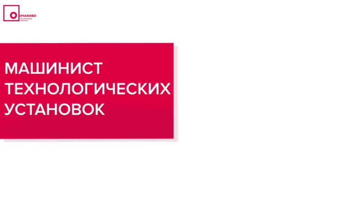

Белый фон, логотип «Очаково» в левом верхнем углу, малиновая плашка с белым названием профессии.

### 00:01 · Вход на участок
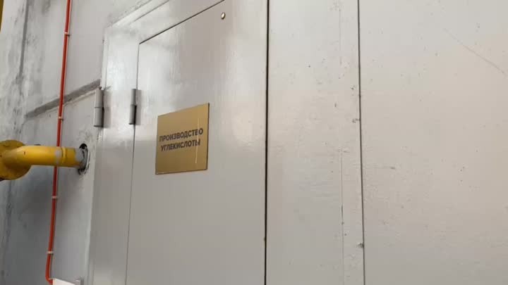

Крупно металлическая дверь с золотистой табличкой (читается «Производство углекислоты») **(?)** и жёлтая газовая труба.

### 00:02–00:03 · «ПОДГОТОВЬСЯ К РАБОТЕ»
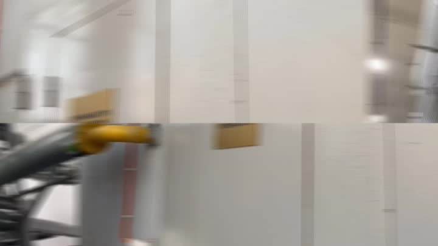 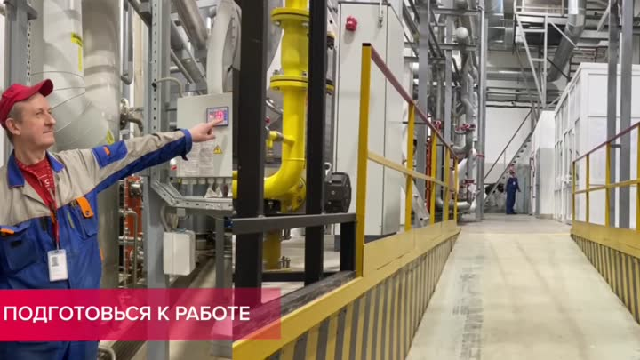

**Надпись на экране:** ПОДГОТОВЬСЯ К РАБОТЕ.

2 с: сотрудник в красной кепке и сине-серой спецовке с бейджем показывает рукой на сенсорную панель на колонне. Вокруг металлическая эстакада с жёлтыми перилами, трубы, жёлтая газовая труба, в глубине цеха второй сотрудник.

3 с: оранжевое оборудование и труба с красной ручкой крана, на трубах наклейки **«МОНОЭТАНОЛАМИН (МЭА)»** и стрелки направления потока.

### 00:04–00:07 · «СЛЕДИ ЗА РАБОТОЙ»
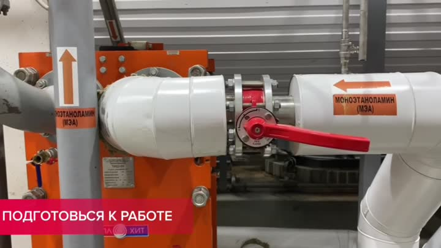 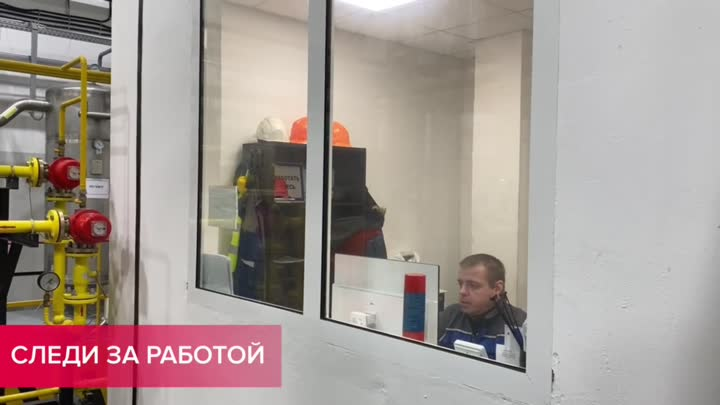 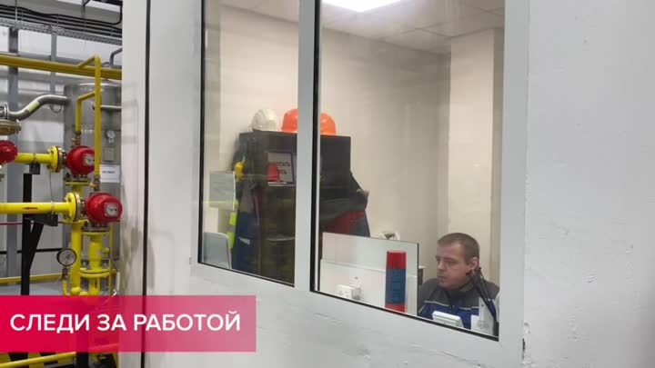 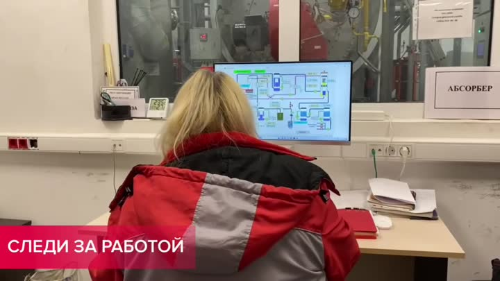

**Надпись:** СЛЕДИ ЗА РАБОТОЙ.

4–5 с: кадр снят через окно операторской: внутри сидит оператор в синей форме, на заднем плане оранжевая и белая каски; на переднем плане красные газовые вентили и манометры.

6–7 с: женщина в красной жилетке сидит за столом перед монитором с **мнемосхемой** установки; справа табличка **«АБСОРБЕР»**, бумажные журналы.

### 00:08–00:11 · «КОНТРОЛИРУЙ И УПРАВЛЯЙ»
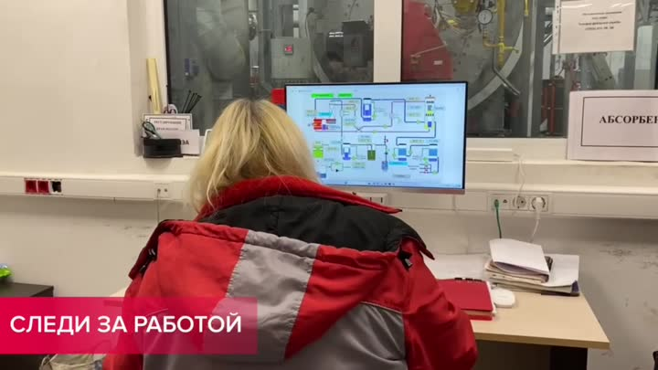 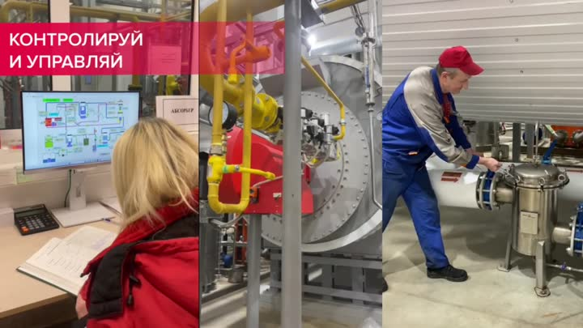 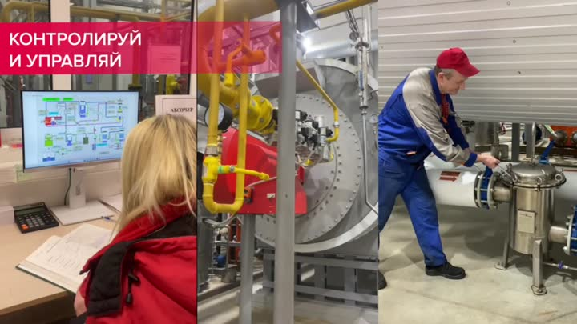 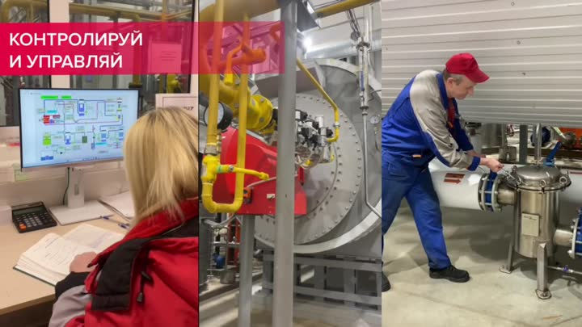

**Надпись:** КОНТРОЛИРУЙ И УПРАВЛЯЙ.

Трёхчастный коллаж на экране:
1. Слева: женщина за столом смотрит на монитор со схемой, рядом калькулятор и открытый журнал (запись показаний).
2. В центре: жёлтая труба, красный агрегат (горелка/насос), большой круглый люк оборудования.
3. Справа: сотрудник в красной кепке и синем комбинезоне **вручную поворачивает вентиль** на белой трубе рядом с серебристым фильтром-грязевиком.

### 00:12–00:13 · «НАСТАВНИКИ ВСЕМУ НАУЧАТ»
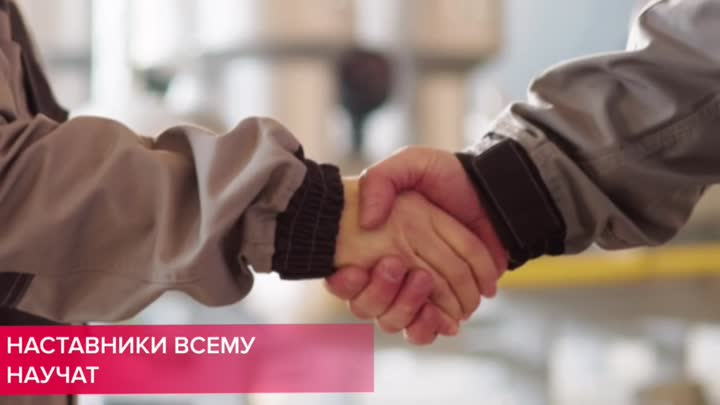 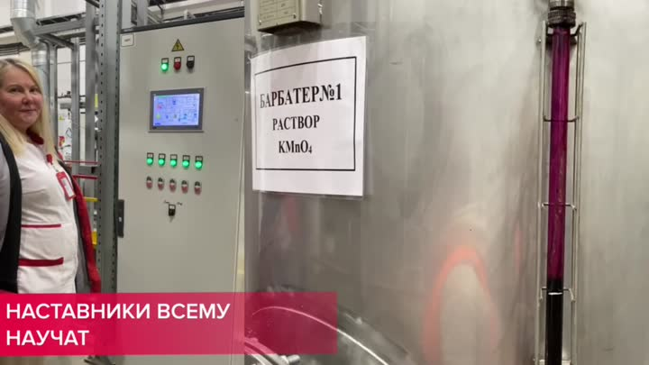

**Надпись:** НАСТАВНИКИ ВСЕМУ НАУЧАТ.

12 с: рукопожатие на размытом фоне цеха.

13 с: женщина в красно-белой форме у шкафа управления (панель с зелёными лампами и сенсорным экраном). На ёмкости табличка: **«БАРБОТЕР №1 РАСТВОР KMnO₄»**.

### 00:14–00:22 · «ЗАКРЕПЛЯЙ ПРОЙДЕННЫЙ МАТЕРИАЛ»
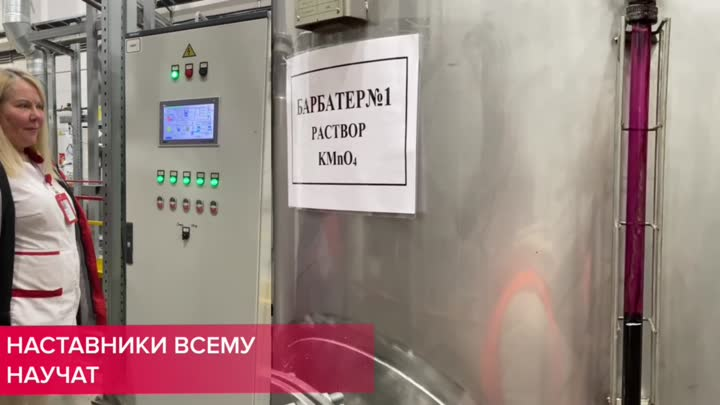 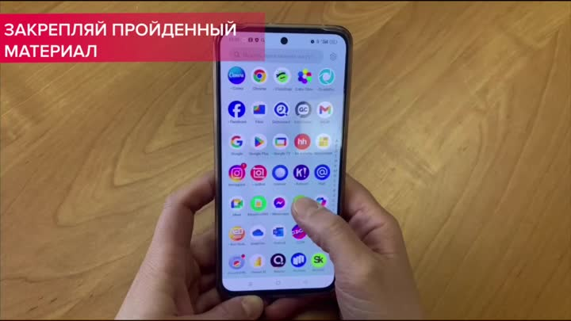 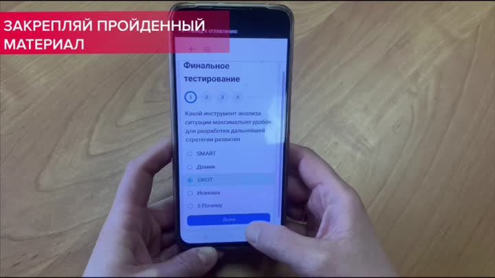 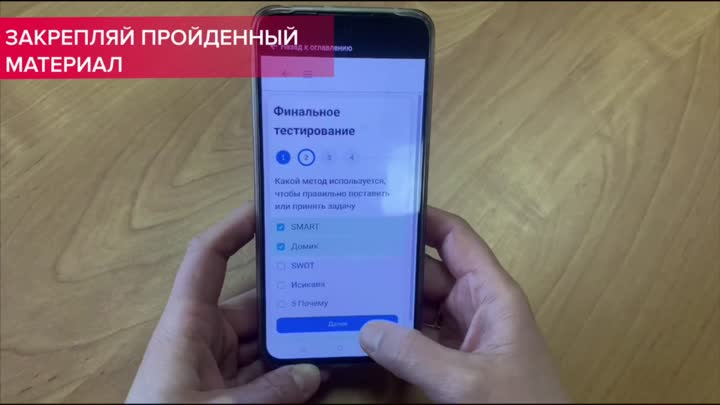

**Надпись:** ЗАКРЕПЛЯЙ ПРОЙДЕННЫЙ МАТЕРИАЛ.

Снято сверху: руки держат смартфон на деревянном столе.
- 14–17 с: экран с иконками приложений (виден значок hh.ru), палец выбирает иконку учебного приложения.
- 18–21 с: экран **«Финальное тестирование»**, 4 шага. Вопрос: *«Какой метод используется, чтобы правильно поставить или принять задачу»*; варианты: **SMART, Домик, SWOT, Исикава, 5 Почему**. Кнопка «Далее».
- 22 с: задание на сопоставление: слева «Правильно поставить цель» и «Проанализировать информацию для разработки дальнейшей стратегии», справа SMART, Исикава, 5 почему, SWOT. Тест общий (менеджмент), не узкотехнический.

### 00:23–00:24 · «ТВОЯ ТОЧНОСТЬ — НАШ УСПЕХ»
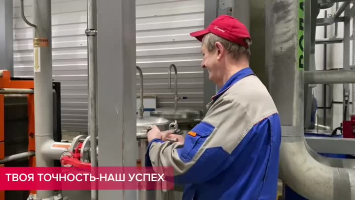 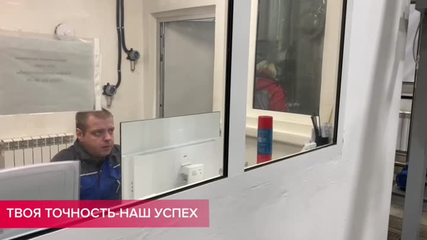

**Надпись:** ТВОЯ ТОЧНОСТЬ-НАШ УСПЕХ.

23 с: улыбающийся сотрудник в красной кепке и синем комбинезоне держит руку на крупном красном вентиле на трубопроводе.

24 с: оператор в операторской смотрит на экран.

### 00:25–00:28 · Планы оборудования (без титров)
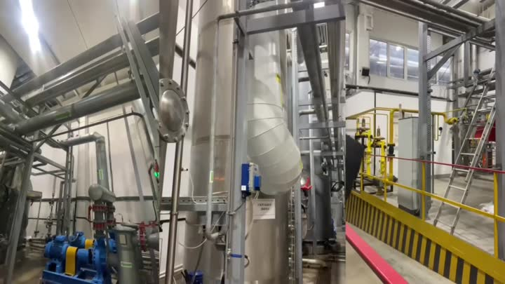 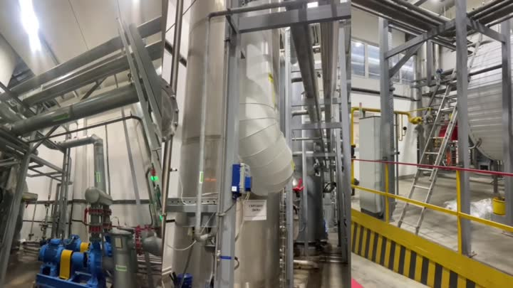 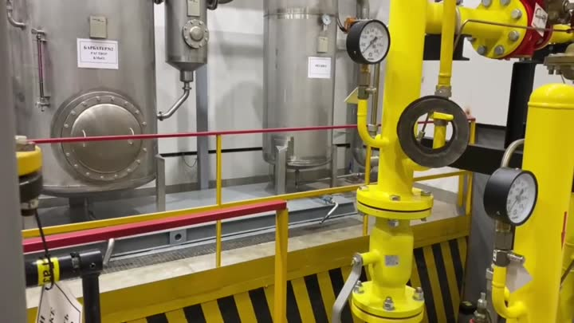 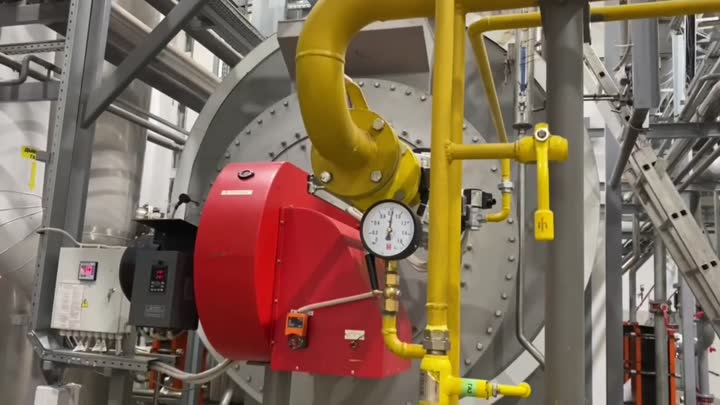

25 с: широкий вид цеха: лестницы, трубы, синий насос, жёлтая разметка.

26 с: размытое движение камеры вдоль жёлтых труб с манометрами.

27 с: красный агрегат (горелка) с манометром, жёлтая газовая труба.

28 с: труба с надписью **«ВОДА»** и зелёной/красной стрелками потока, красные ручные задвижки, большая круглая заслонка/вентилятор, **синие бочки на поддоне** в жёлтом поддоне-ловушке (хранение реагентов), фильтры.

### 00:29–00:30 · Титр «МАШИНИСТ ТЕХНОЛОГИЧЕСКИХ УСТАНОВОК»
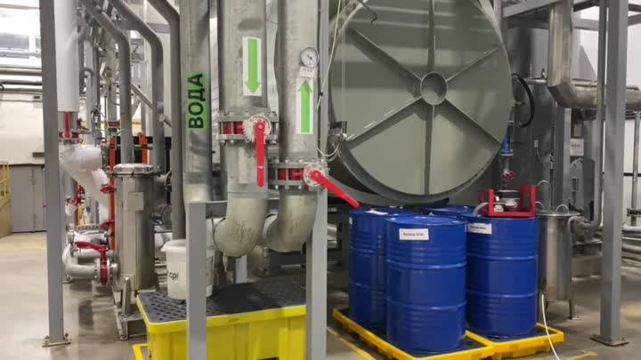 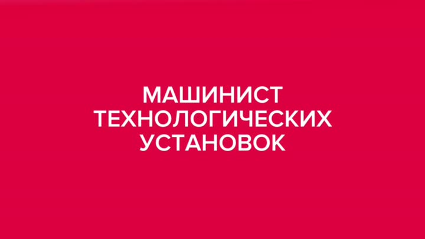

Красный экран, белым названием профессии.

### 00:31 · Логотип
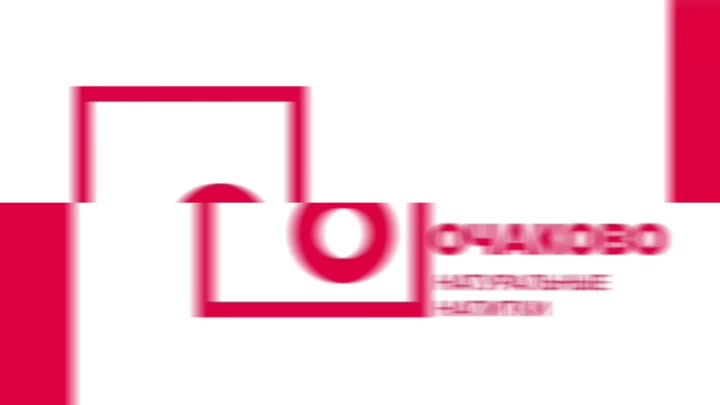

Большой логотип **«ОЧАКОВО. Натуральные напитки»** на белом фоне.

### 00:32–00:34 · «ПРИСОЕДИНЯЙСЯ К НАМ» + QR
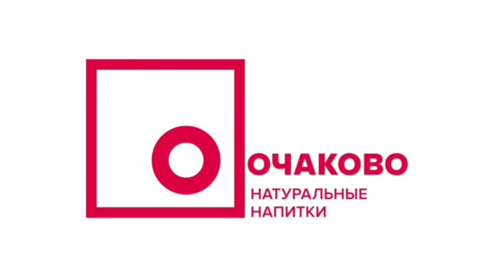 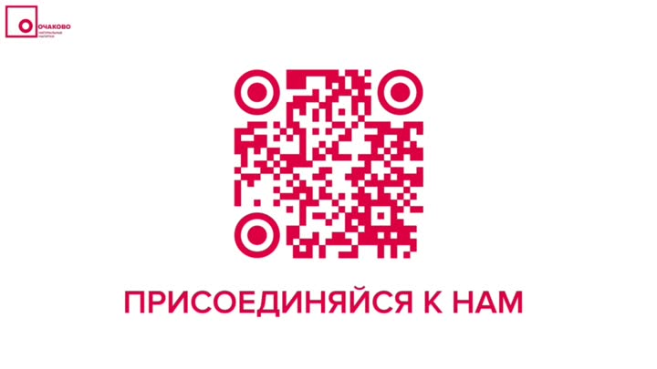 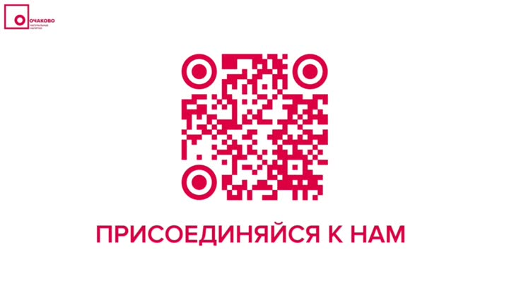

Белый экран, малиновый QR-код и надпись **«ПРИСОЕДИНЯЙСЯ К НАМ»**. Ссылка в кадре не указана (только QR).

## Что делает машинист (по видеоряду)
- Подготовка к смене, осмотр участка.
- Наблюдение за процессом на мониторе-мнемосхеме в операторской.
- Контроль манометров и показаний на местных панелях, ведение журнала, расчёты.
- Ручное управление арматурой: вентили, задвижки, переключение потоков.
- Работа с технологическими средами: моноэтаноламин (МЭА), вода, раствор KMnO₄ в барботёре **(?)**.

## Идеи для игры (по этому ролику)
- «Пульт машиниста»: схема с трубами, у каждого узла манометр с допуском.
- «Обход»: пройти маршрут, открыть/закрыть нужный вентиль по маркировке на трубе (МЭА / вода / газ).
- «Журнал смены»: снять показания и записать в таблицу.
- Мини-тест «Закрепи материал» (SMART/SWOT и т. д.) как в ролике.
