# Расшифровка: «Оператор линии розлива»

> **Речь в видео отсутствует.** Аудиодорожка проверена русской моделью распознавания речи (GigaAM CTC): текста не найдено, на спектрограмме ритмичная музыка без голоса. Поэтому «расшифровка» состоит из (1) **текста, который виден на экране** (титры, плашки, вывески, надписи на оборудовании, интерфейс телефона) и (2) **подробного описания видеоряда**.
> Тайм-коды приблизительные (±1 с). Кадры лежат в папке `02_operator_rozliva_frames/` (по 1 кадру в секунду, имя `tNNN.jpg`, где NNN−1 = секунда). Места, где не уверен, помечены **(?)**.

**Файл:** `03378611-…mp4` · 1280×720 · 37 с · без речи, фоновая музыка

## Кратко
Ролик про оператора линии розлива напитков в банки. Все кадры в красно-малиновой гамме: красные банки «Очаково» (в кадре «Джин & Грейпфрут»), сенсорные панели машин, упаковка, паллеты. Показан путь: переодеться → подойти к линии → контролировать → учиться у наставника → упаковка/паллеты → обучение в приложении.

## Полная расшифровка по сегментам

### 00:00–00:02 · Заставка: банки на конвейере (без титров)
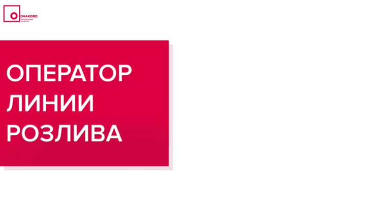 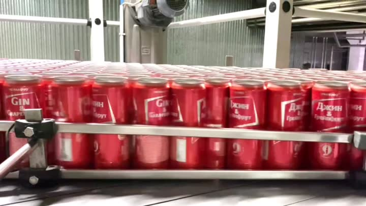 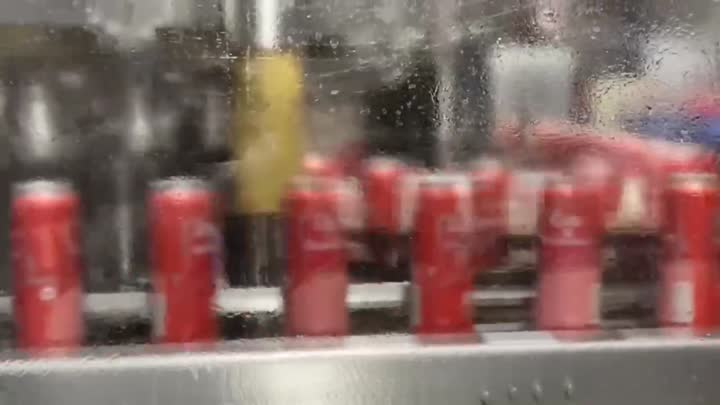

0 с: крупно ряды красных банок **«Очаково» «Джин & Грейпфрут / Gin & Grapefruit»** на конвейере.

1 с: банки бегут за мокрым стеклом (размытие).

2 с: банки по одной едут по синему конвейеру к спиральному подъёмнику/накопителю.

### 00:03–00:06 · «НАДЕНЬ ФОРМУ»
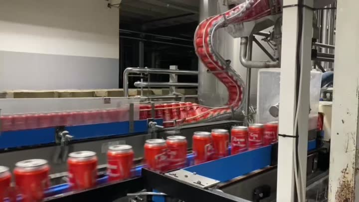 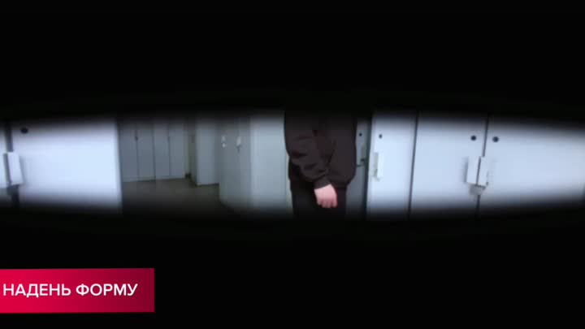 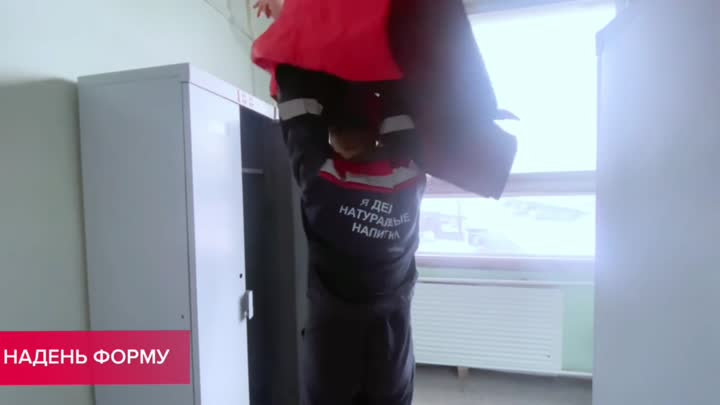 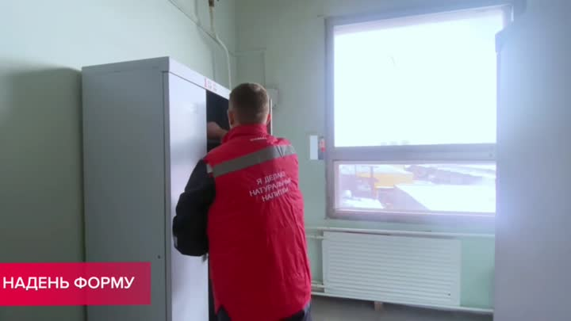

**Надпись:** НАДЕНЬ ФОРМУ.

3 с: молодой человек в чёрной толстовке открывает серый шкафчик в раздевалке (до переодевания).

4–6 с: тот же сюжет, сотрудник уже в форме: красная куртка с надписью на спине **«Я делаю натуральные напитки»**, шкафчик, окно с зимним видом.

### 00:07–00:08 · «ПОДГОТОВЬСЯ К РАБОТЕ»
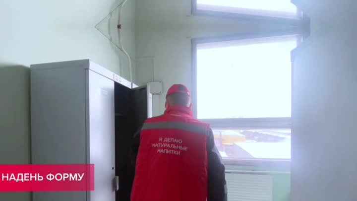 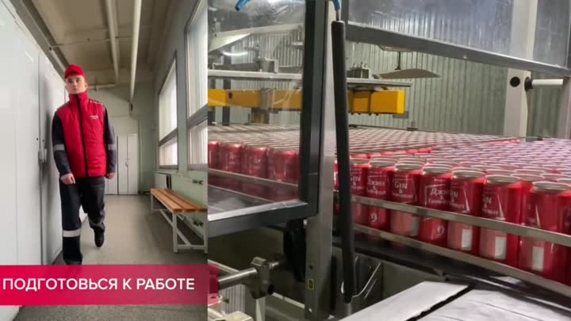

**Надпись:** ПОДГОТОВЬСЯ К РАБОТЕ.

Сотрудник в красной куртке идёт по коридору раздевалки (скамейка, шкафчики). Параллельно вид на ряды банок на конвейере.

### 00:09–00:11 · «СЛЕДИ ЗА РАБОТОЙ»
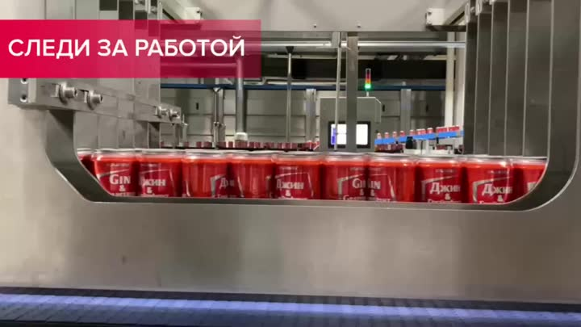 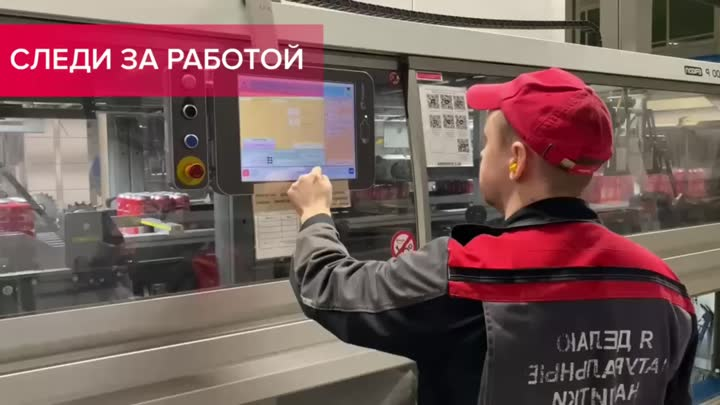 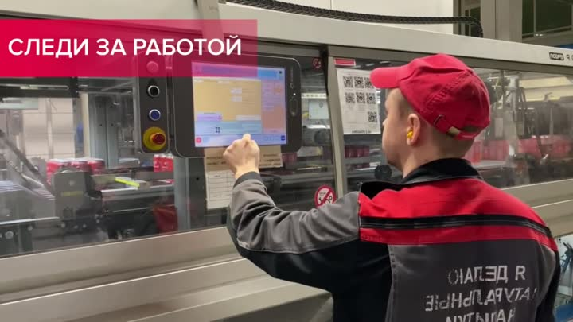

**Надпись:** СЛЕДИ ЗА РАБОТОЙ.

9 с: банки движутся внутри машины (смотровое окно из нержавеющей стали).

10 с: оператор в красной кепке и **жёлтых берушах** нажимает на сенсорный экран панели машины (в углу видны QR-коды-инструкции и знак запрета).

11 с: спиральный конвейер с банками (подъёмник), синий конвейер.

### 00:12–00:15 · «КОНТРОЛИРУЙ И УПРАВЛЯЙ»
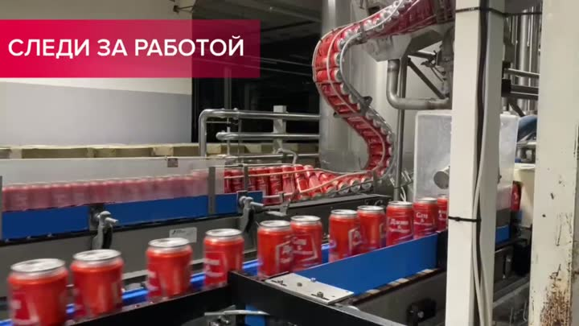 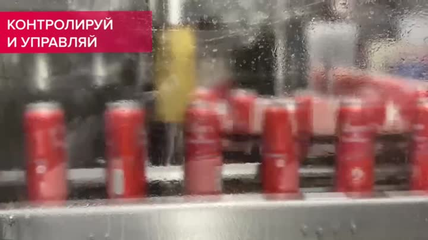 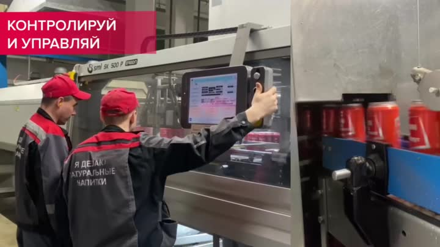 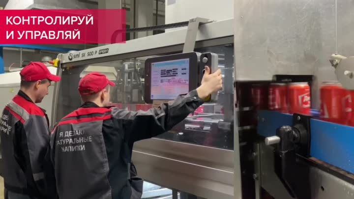

**Надпись:** КОНТРОЛИРУЙ И УПРАВЛЯЙ.

12 с: крупно сенсорный экран с кнопками режимов, под ним колонка-светофор (три сигнальные лампы) и красная кнопка аварийной остановки.

13–15 с: двое операторов в красных кепках у машины с маркировкой **SMI SK 500 P** (упаковочная машина) **(?)**. Один поддерживает панель на поворотной консоли и показывает другому, что нажимать.

### 00:16–00:20 · «НАСТАВНИКИ ВСЕГДА ПОМОГУТ»
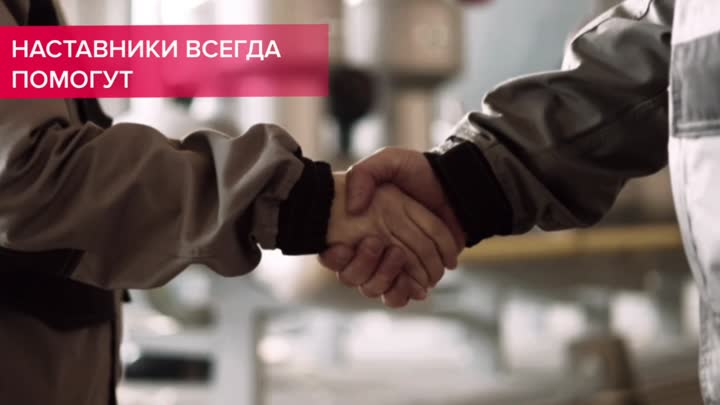 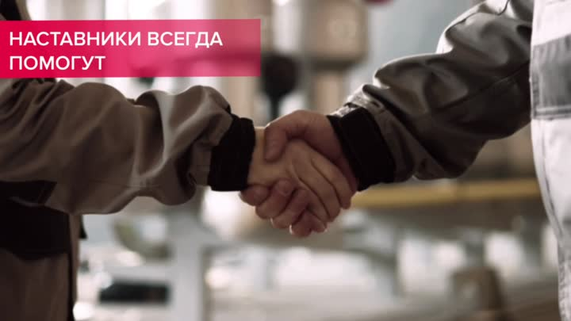 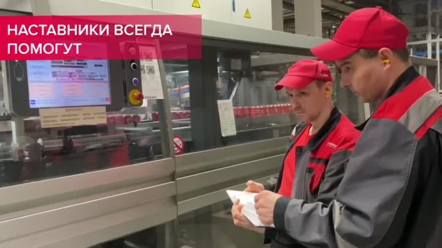 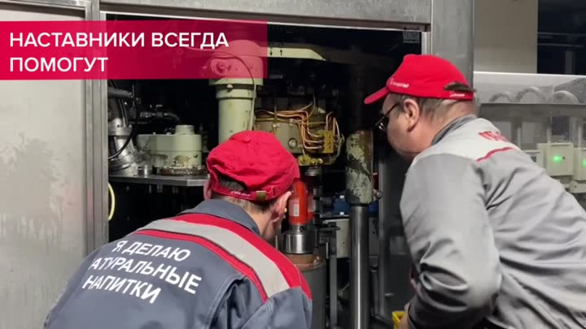

**Надпись:** НАСТАВНИКИ ВСЕГДА ПОМОГУТ.

16 с: рукопожатие на размытом фоне.

17–18 с: наставник и стажёр у панели, один показывает на экран, другой записывает в блокнот.

19–20 с: двое присели у **открытой машины**: видна механика (вал, провода, насос/узел), наставник в серо-красной куртке с надписью «Очаково» объясняет, как заменить/обслужить деталь.

### 00:21–00:23 · «ТВОЯ ТОЧНОСТЬ — НАШ УСПЕХ»
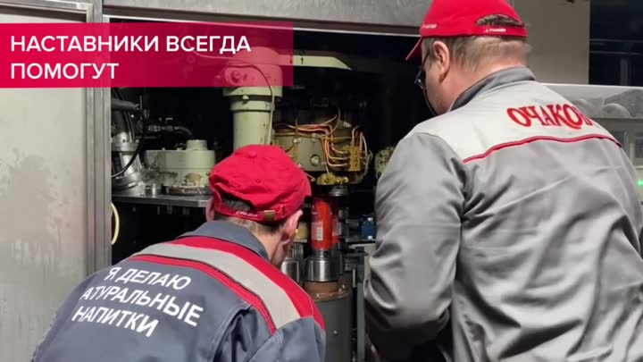 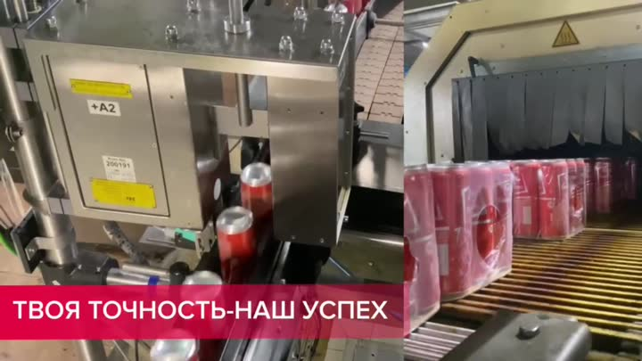 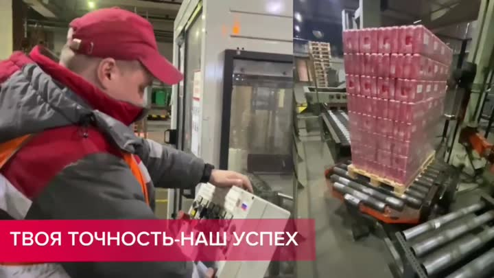

**Надпись:** ТВОЯ ТОЧНОСТЬ-НАШ УСПЕХ.

21 с: коллаж: панель упаковщика с лотками и термоусадочный туннель, красные блоки банок в плёнке.

22–23 с: сотрудник в оранжевом жилете берёт картонный блок у паллетайзера; на заднем плане паллета с банками в красной плёнке на роликовом конвейере.

### 00:24–00:25 · «ОБУЧАЙСЯ ЛЕГКО И ПРОСТО»
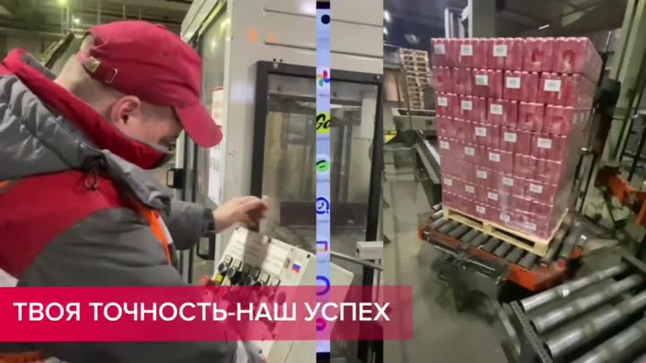 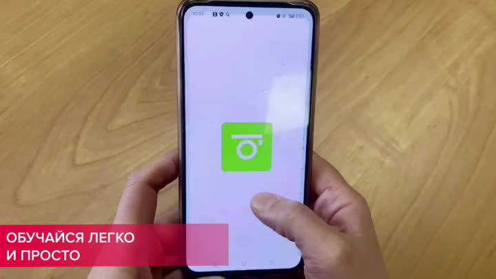

**Надпись:** ОБУЧАЙСЯ ЛЕГКО И ПРОСТО.

Руки держат смартфон. На экране заставка приложения **«Mirapolis»** (система дистанционного обучения). Затем виден экран приложений.

### 00:26–00:30 · Линия розлива и упаковки (без титров)
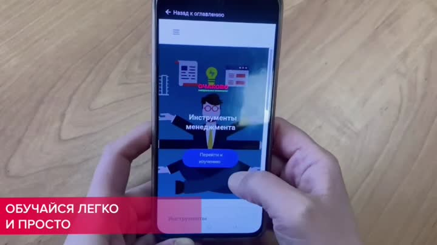 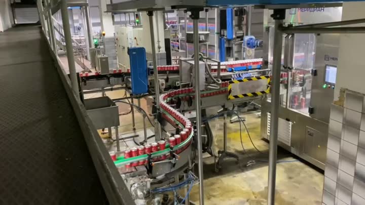 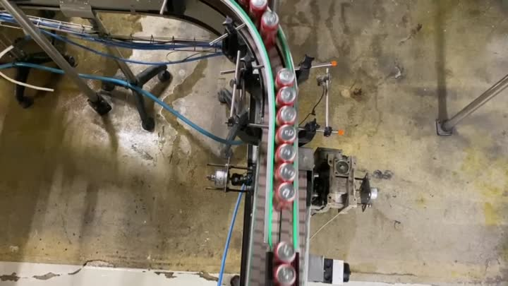 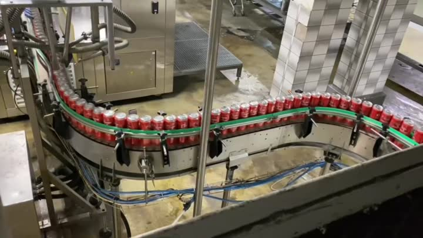

26 с: блоки банок в плёнке выезжают из термоусадочного туннеля.

27–29 с: изогнутые конвейеры с банками, зелёные направляющие, мокрый бетонный пол, синие пневмошланги; вид сверху на поворот конвейера.

30 с: коллаж: линия, оператор у панели (со спины), готовые блоки банок.

### 00:31–00:32 · Титр «ОПЕРАТОР ЛИНИИ РОЗЛИВА»
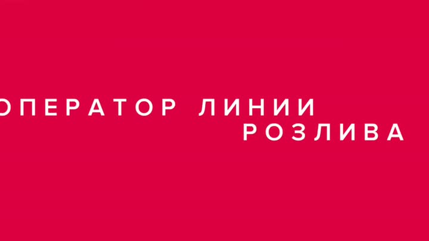 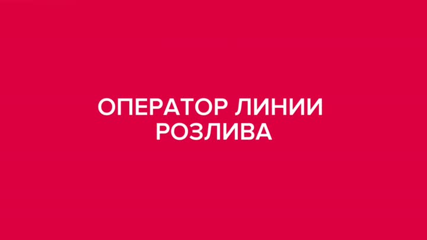

Красный экран с белой надписью **«ОПЕРАТОР ЛИНИИ РОЗЛИВА»**, анимированная графика.

### 00:33 · Логотип
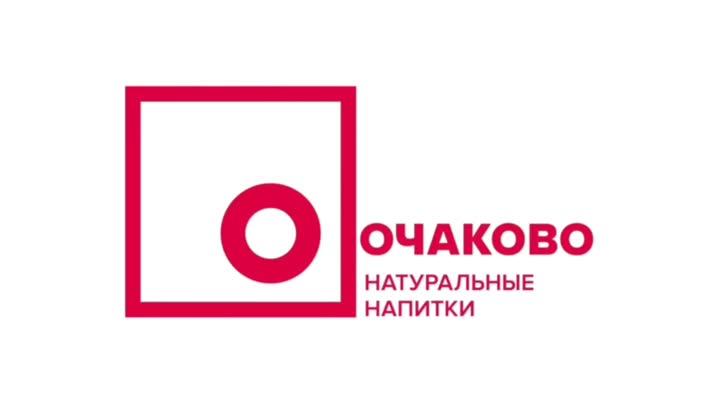

Логотип **«ОЧАКОВО. Натуральные напитки»**.

### 00:34–00:36 · «ПРИСОЕДИНЯЙСЯ К НАМ» + QR
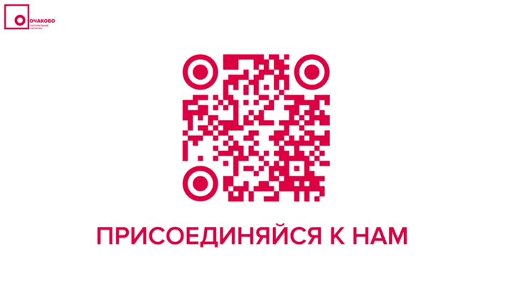 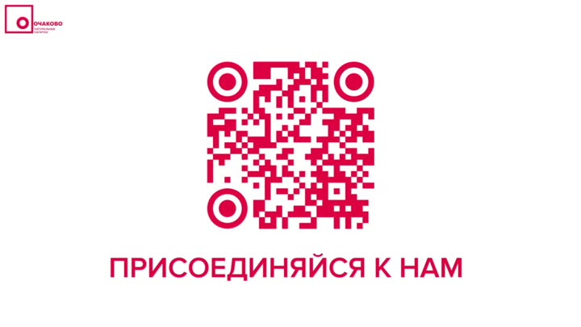 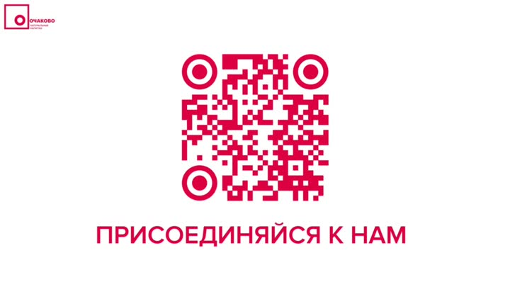

QR-код и надпись **«ПРИСОЕДИНЯЙСЯ К НАМ»**.

## Что делает оператор (по видеоряду)
- Переодевается в форму (красная куртка/серо-красный комбинезон, закрытая обувь, беруши).
- Следит за потоком банок и состоянием машины.
- Работает с сенсорной панелью (режимы, аварийная остановка, сигнальные лампы).
- Обслуживает и меняет узлы машины вместе с наставником.
- Участвует в упаковке: блоки банок в плёнке, паллеты.
- Проходит обучение в приложении (Mirapolis).

## Идеи для игры (по этому ролику)
- Аркада «Линия»: поток банок, убрать брак, не допустить затора.
- «Панель оператора»: кнопки режимов, индикаторы, красная аварийная.
- «Смена детали»: перетащить нужную деталь на нужное место.
- «Паллета»: уложить блоки в слои.
- Экран «Одень героя» перед началом смены.
