# Расшифровка: «Лаборант»

> **Речь в видео отсутствует.** Аудиодорожка проверена русской моделью распознавания речи (GigaAM CTC): текста не найдено, на спектрограмме ритмичная музыка без голоса. Поэтому «расшифровка» состоит из (1) **текста, который виден на экране** (титры, плашки, вывески, надписи на оборудовании, интерфейс телефона) и (2) **подробного описания видеоряда**.
> Тайм-коды приблизительные (±1 с). Кадры лежат в папке `03_laborant_frames/` (по 1 кадру в секунду, имя `tNNN.jpg`, где NNN−1 = секунда). Места, где не уверен, помечены **(?)**.

**Файл:** `6975830a-…mp4` · 1280×720 · 32 с · без речи, фоновая музыка

## Кратко
Ролик о работе лаборанта по контролю качества напитков: светлая лаборатория, белые халаты, перчатки, стеклянная посуда, титрование, органолептическая оценка, рефрактометр, пробы продукции на столах. В конце тест на телефоне.

## Полная расшифровка по сегментам

### 00:00 · Титр «ЛАБОРАНТ»
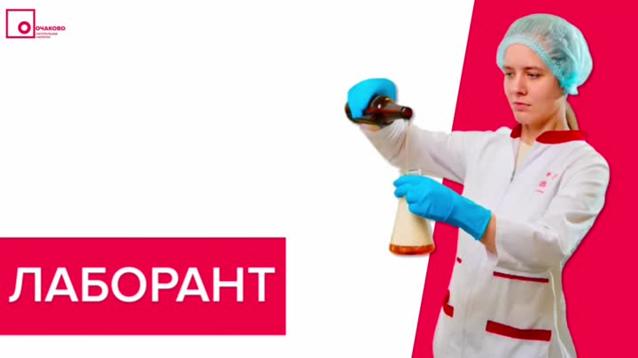

Белый слайд с малиновой плашкой «ЛАБОРАНТ»; девушка в шапочке и голубых перчатках держит бутылку и колбу.

### 00:01–00:02 · Лаборатория (общий план)
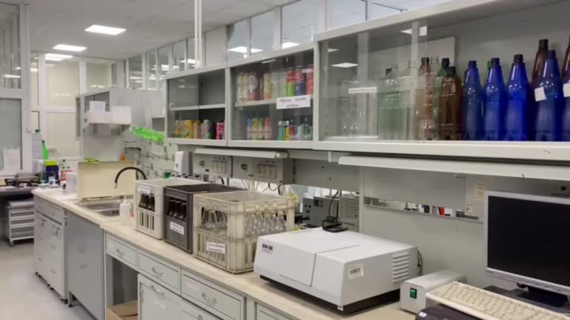 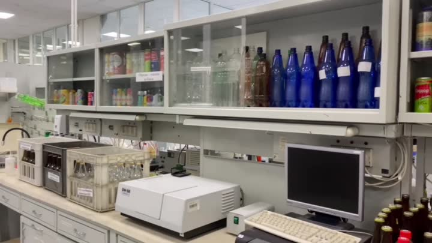

Стеллажи с образцами напитков (ПЭТ-бутылки, синие и коричневые бутылки, банки), компьютер, лабораторный прибор (спектрофотометр/анализатор) **(?)**, ящики с бутылками, мойка и сушилка.

### 00:03–00:05 · «НАДЕНЬ ФОРМУ»
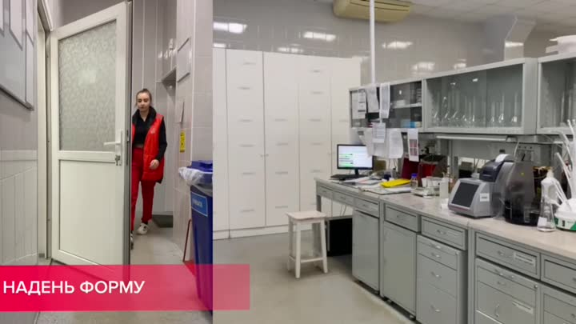 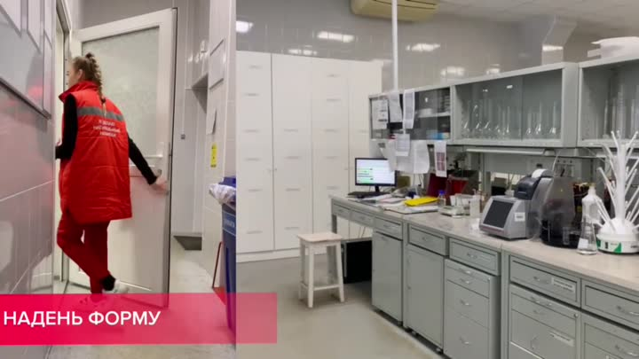 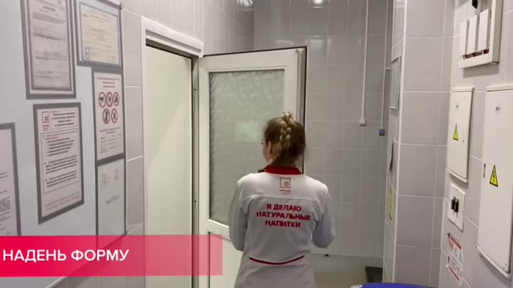

**Надпись:** НАДЕНЬ ФОРМУ.

Девушка в красной жилетке и красных брюках у двери лаборатории; затем входит в лабораторию в белом халате с красной отделкой. На стене у двери информационные листы и знаки.

### 00:06–00:07 · «КОНТРОЛИРУЙ ПРОЦЕСС»
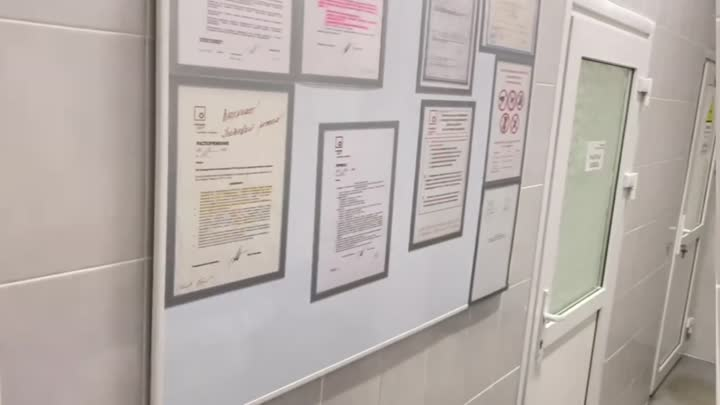 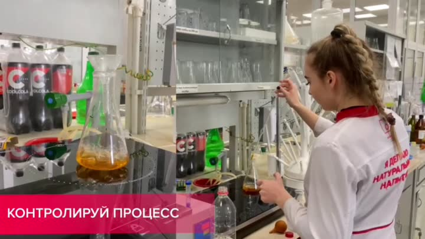

**Надпись:** КОНТРОЛИРУЙ ПРОЦЕСС.

Лаборантка с косой, халат с надписью на спине **«Я делаю натуральные напитки»**. Она стоит у лабораторного стола с вытяжкой и держит бюретку/пипетку над **конической колбой с жёлто-оранжевой жидкостью**: это титрование (определение показателя по капле) **(?)**. На столе бутылки **CoolCola**.

### 00:08–00:09 · «ВЫПОЛНЯЙ ОРГАНОЛЕПТИЧЕСКИЕ АНАЛИЗЫ»
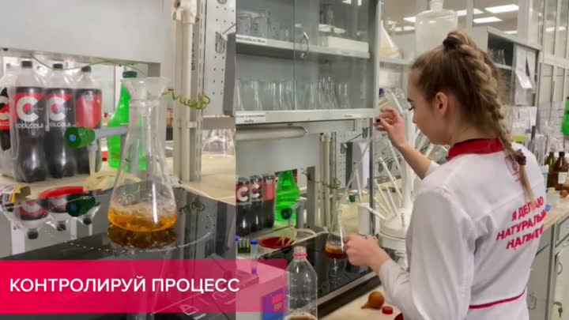 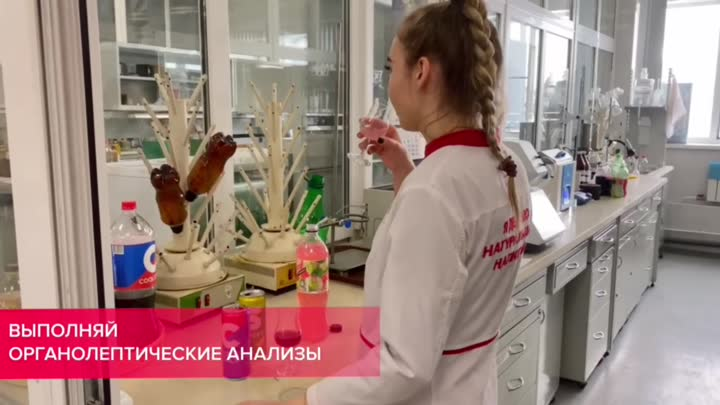

**Надпись:** ВЫПОЛНЯЙ ОРГАНОЛЕПТИЧЕСКИЕ АНАЛИЗЫ.

Лаборантка пробует образец из стакана (оценка вкуса, запаха). Рядом бутылка колы, сушилка для посуды с перевёрнутыми бутылками, весы, лабораторный стол.

### 00:10–00:12 · «НАСТАВНИКИ ВСЕМУ НАУЧАТ»
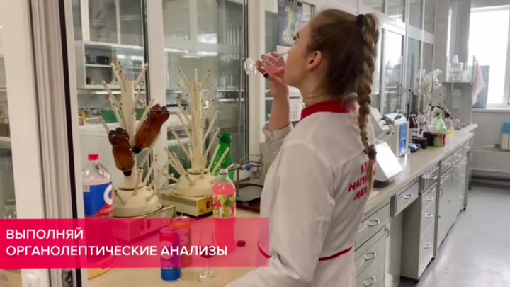 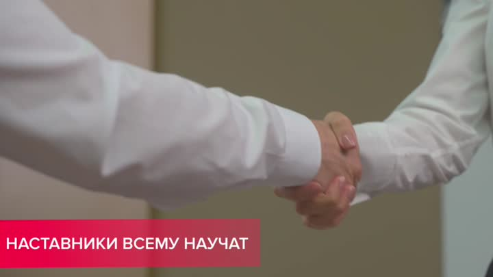 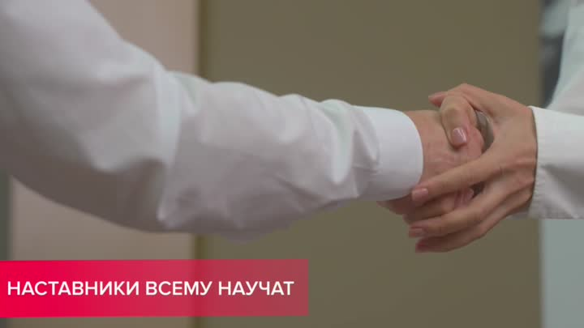

**Надпись:** НАСТАВНИКИ ВСЕМУ НАУЧАТ.

Рукопожатие на размытом фоне, рука протянута к камере.

### 00:13–00:16 · «ПРОВЕРЯЙ КАЧЕСТВО»
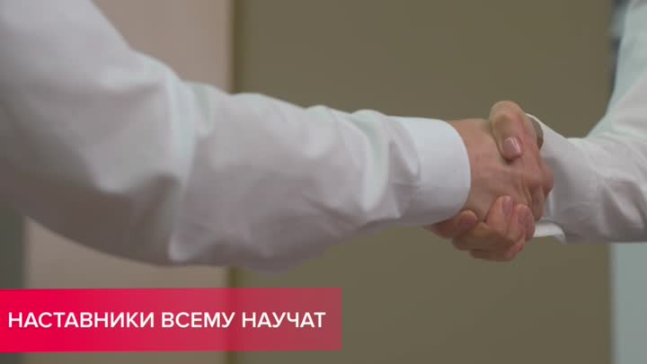 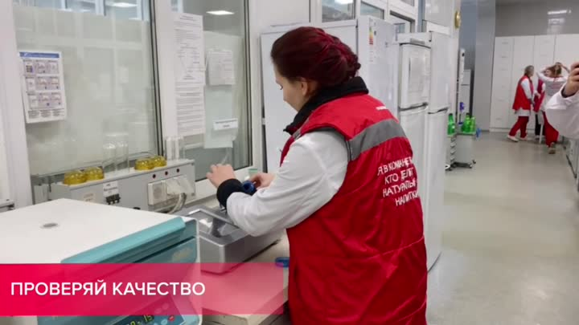 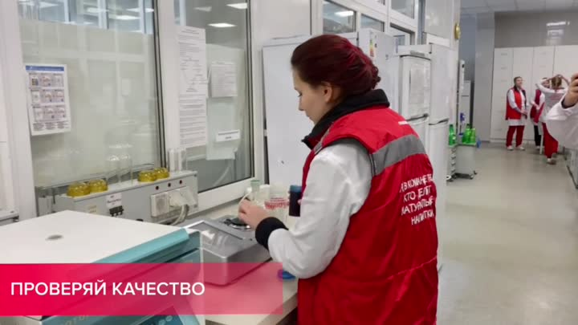 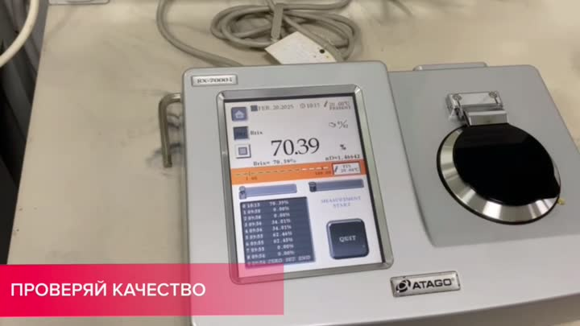

**Надпись:** ПРОВЕРЯЙ КАЧЕСТВО.

13–14 с: сотрудница с красно-тёмными волосами в красной жилетке работает у лабораторного прибора (термостат/центрифуга) **(?)**. На заднем плане ещё сотрудницы в красно-белой форме.

15–16 с: крупно **рефрактометр ATAGO** (серия RX-7000i): цветной сенсорный экран с результатами измерений, круглая призма для нанесения пробы. Измеряется показатель преломления / содержание сухих веществ (Brix) **(?)**.

### 00:17–00:18 · «ОБУЧАЙСЯ ЛЕГКО И ПРОСТО»
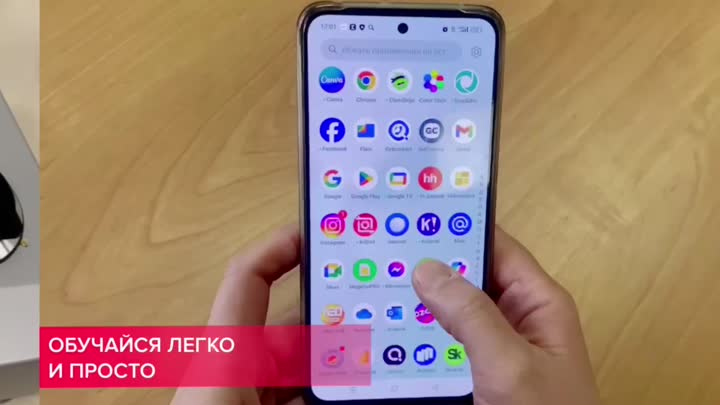 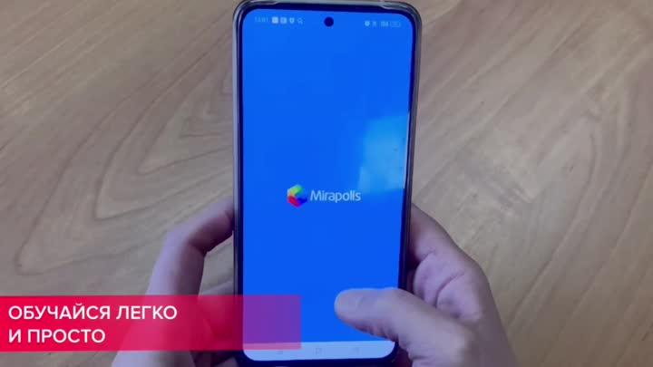

**Надпись:** ОБУЧАЙСЯ ЛЕГКО И ПРОСТО.

Руки держат смартфон. Экран приложений, затем заставка курса **«Инструменты менеджмента»** (кнопка «Перейти к изучению»).

### 00:19 · «ЗАКРЕПЛЯЙ ПРОЙДЕННЫЙ МАТЕРИАЛ»
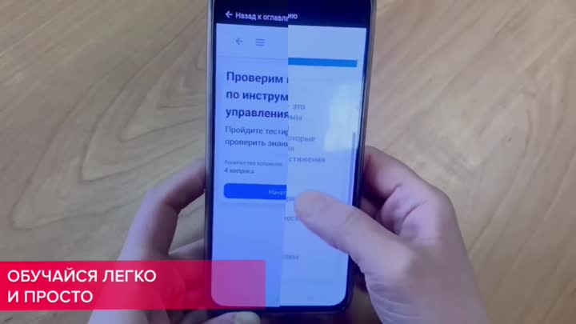

**Надпись:** ЗАКРЕПЛЯЙ ПРОЙДЕННЫЙ МАТЕРИАЛ.

Экран **«Финальное тестирование»**: вопрос *«Какой инструмент анализа ситуации максимально удобен для разработки дальнейшей стратегии развития»*; варианты SMART, Домик, SWOT, Исикава, 5 Почему.

### 00:20–00:25 · Рабочие процессы (без титров)
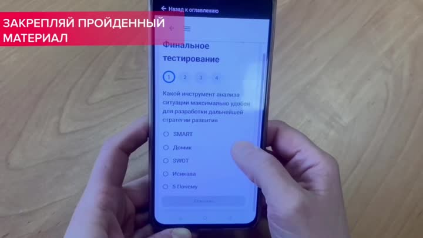 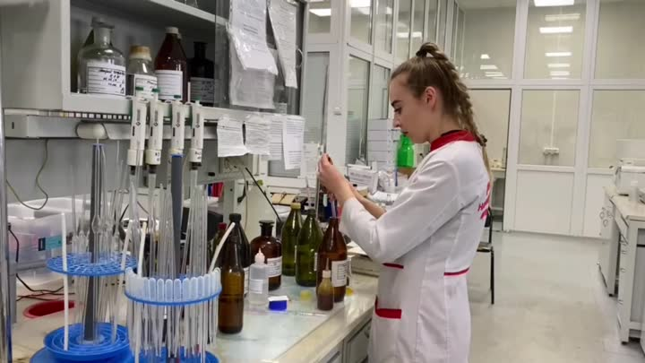 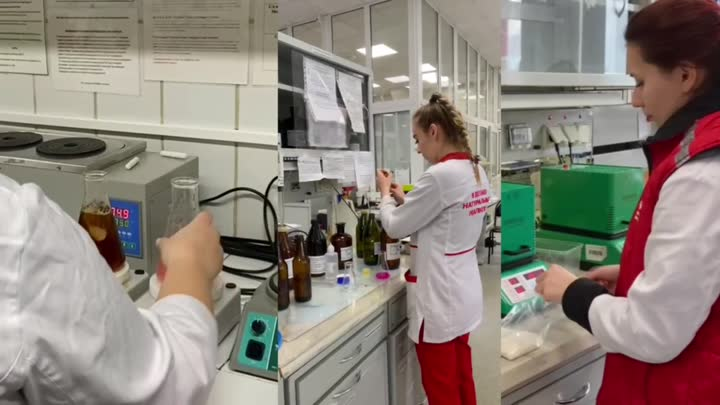 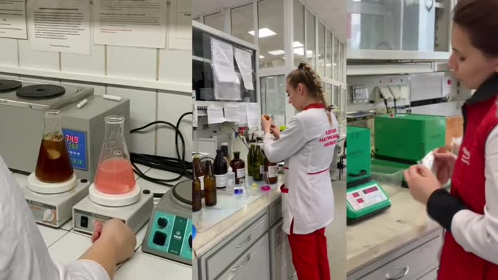

20 с: столик с образцами: стеклянные бутылки «Ах!», банки, ПЭТ, энергетики и квас-подобные напитки.

21 с: лаборантка с косой работает у штатива с пробирками/пипетками.

22–25 с: коллаж из трёх кадров: нагревательные плитки с колбами (в одной коричнево-красная жидкость, в другой розовая), цифровой индикатор температуры, лаборантка у стола с бутылками, сотрудница в красной жилетке, зелёный прибор (термостат/мешалка) **(?)**.

### 00:26 · Титр «ЛАБОРАНТ»
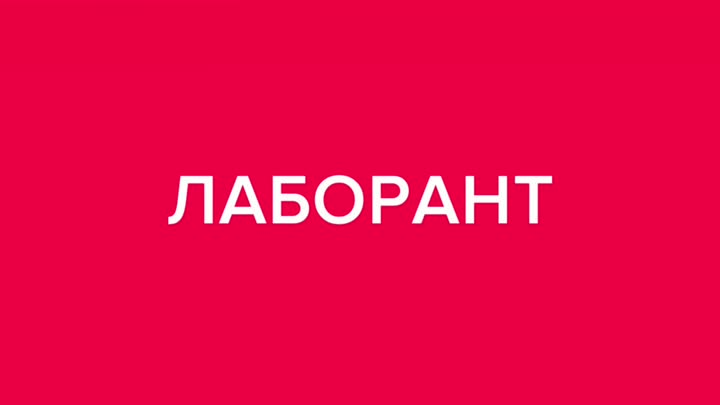

Красный экран с названием профессии.

### 00:27–00:28 · Логотип
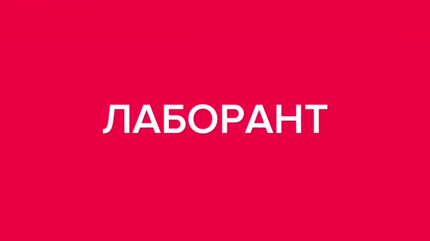 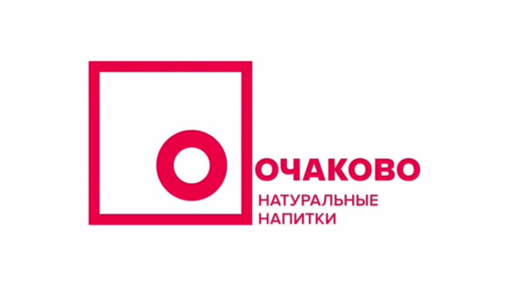

Анимированное появление логотипа **«ОЧАКОВО. Натуральные напитки»**.

### 00:29–00:31 · «ПРИСОЕДИНЯЙСЯ К НАМ» + QR
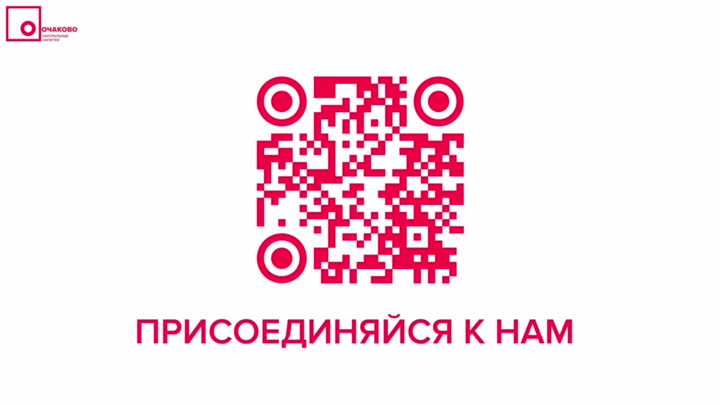  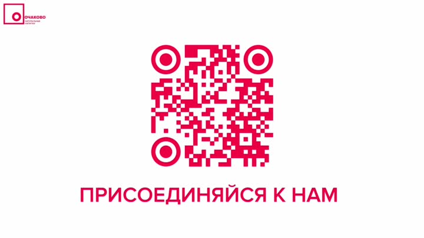

QR-код и надпись **«ПРИСОЕДИНЯЙСЯ К НАМ»**.

## Что делает лаборант (по видеоряду)
- Надевает халат, шапочку, перчатки.
- Берёт пробы продукции и сравнивает образцы.
- Проводит химический анализ (титрование, нагрев растворов, смешивание).
- Измеряет параметры на приборах (рефрактометр и др.).
- Проводит органолептическую оценку (вкус, запах, цвет).
- Работает с компьютером и бумажной документацией (результаты, протоколы).

## Идеи для игры (по этому ролику)
- «Титрование»: по каплям добавлять реагент, остановиться в момент смены цвета.
- «Рефрактометр»: считать показание, сравнить с допуском.
- «Органолептика»: найти образец, отличающийся от эталона.
- «Сортировка проб»: разложить образцы по партиям и этикеткам.
